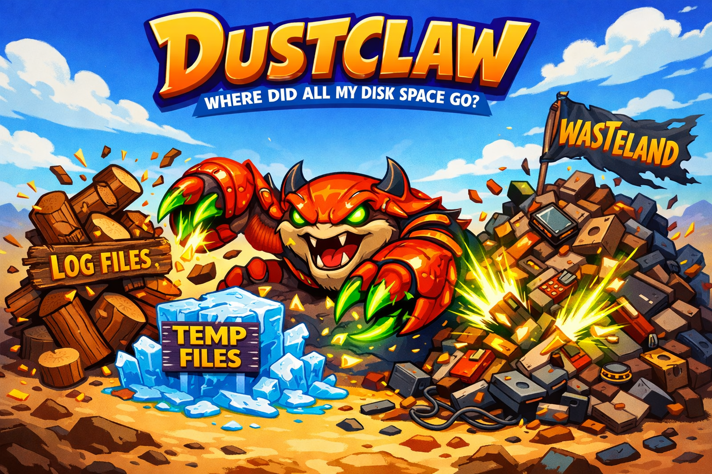

# Dustclaw 🦀

[](https://www.npmjs.com/package/dustclaw)
[](https://github.com/psandis/dustclaw/actions/workflows/ci.yml)

Find out what is eating your disk space and where the bloat is hiding.

<p align="center">
  
</p>

`dustclaw` answers the question every developer asks once a month: where did all my disk space go?

It scans your disk, shows you what is big, and knows where macOS and dev tools hide gigabytes of caches, build artifacts, and forgotten dependencies. Plain table output by default. Use `--json` for scripts and automation.

## Why Dustclaw Exists

There are excellent disk space tools out there: [dust](https://github.com/bootandy/dust) and [dua-cli](https://github.com/Byron/dua-cli) are blazing fast Rust scanners, [duf](https://github.com/muesli/duf) is a beautiful Go replacement for `df`, and [npkill](https://github.com/voidcosmos/npkill) is great for cleaning up `node_modules`.

Dustclaw takes a different angle. It focuses on dev-aware scanning and lives in the npm ecosystem:

- **Dev-aware scanning**: knows about Xcode DerivedData, Docker data, Homebrew caches, Playwright browsers, Gradle, Maven, Cargo, and dozens of other known space wasters
- **Cache breakdown**: shows every application cache individually instead of one mystery lump
- **Safe cleanup**: separates what is safe to delete from what needs manual review, prompts per item
- **npm-installable**: run `npx dustclaw` and you are up

## 10-Second Proof

```bash
npx dustclaw wasteland
```

```
  Wasteland Report

  Known space wasters:

┌─────────────────────────────────────┬──────────┬───────────────────────────────────────────────────────────────────┐
│ Name                                │ Size     │ Path                                                              │
├─────────────────────────────────────┼──────────┼───────────────────────────────────────────────────────────────────┤
│ Docker Desktop                      │ 50.9 GB  │ /Users/you/Library/Containers/com.docker.docker/Data              │
│ Android Emulators                   │ 7.7 GB   │ /Users/you/.android/avd                                           │
│ Puppeteer Cache                     │ 4.0 GB   │ /Users/you/.cache/puppeteer                                       │
│ Cache: Google/Chrome                │ 4.0 GB   │ /Users/you/Library/Caches/Google                                  │
│ pnpm Store                          │ 2.7 GB   │ /Users/you/Library/pnpm/store                                     │
│ Playwright Browsers                 │ 2.2 GB   │ /Users/you/Library/Caches/ms-playwright                           │
│ Cache: com.microsoft.VSCode.ShipIt  │ 1.7 GB   │ /Users/you/Library/Caches/com.microsoft.VSCode.ShipIt             │
│ Cypress Cache                       │ 1.3 GB   │ /Users/you/Library/Caches/Cypress                                 │
│ Gradle Cache                        │ 2.5 GB   │ /Users/you/.gradle/caches                                         │
│ Maven Cache                         │ 332.6 MB │ /Users/you/.m2/repository                                         │
└─────────────────────────────────────┴──────────┴───────────────────────────────────────────────────────────────────┘

  Total reclaimable: 81.4 GB

  Scan saved. Run dustclaw clean to remove safe items.
```

Then clean what is safe:

```bash
npx dustclaw clean --force
```

```
  Safe to clean:

┌──────────────────────┬────────┬──────────────────────────────────┐
│ Name                 │ Size   │ Path                             │
├──────────────────────┼────────┼──────────────────────────────────┤
│ Gradle Cache         │ 2.5 GB │ /Users/you/.gradle/caches        │
│ Puppeteer Cache      │ 4.0 GB │ /Users/you/.cache/puppeteer      │
│ Playwright Browsers  │ 2.2 GB │ /Users/you/Library/Caches/ms-... │
└──────────────────────┴────────┴──────────────────────────────────┘

  WARNING: Deletion is permanent. There is no undo.

  Delete Gradle Cache (2.5 GB)? [y/N] y
  Deleted: /Users/you/.gradle/caches

  Freed: 2.5 GB
```

## Commands

| Command | What it does |
|---------|-------------|
| `dustclaw [path]` | Quick overview: disk usage, free space, top 10 biggest items |
| `dustclaw scan [path]` | Deep scan: ranked list of largest files and folders |
| `dustclaw wasteland` | Finds known space wasters: caches, build artifacts, Trash, Docker |
| `dustclaw clean` | Clean safe items from last wasteland scan (dry run by default) |

## Requirements

- Node.js 22.12+
- macOS, Linux or Windows

CI runs lint, build, tests and the built CLI on all three with Node.js 22 and 24 for every push.

## Install

```bash
npm install -g dustclaw
```

Or run without installing:

```bash
npx dustclaw
```

## Usage

### Overview (default)

```bash
dustclaw
dustclaw ~/Projects         # overview of a specific path
dustclaw -p ~/Projects      # same, as an option
dustclaw -n 20              # show top 20 instead of 10
```

If you pass both a path and `-p`, the path after the command is used.

```
  Disk Usage

┌────────────────────────────┬──────────┬──────────┬───────────┬───────┐
│ Mount                      │ Total    │ Used     │ Available │ Use%  │
├────────────────────────────┼──────────┼──────────┼───────────┼───────┤
│ /                          │ 460.4 GB │ 11.8 GB  │ 56.0 GB   │ 17.4% │
│ /System/Volumes/VM         │ 460.4 GB │ 18.0 GB  │ 56.0 GB   │ 24.3% │
│ /System/Volumes/Preboot    │ 460.4 GB │ 8.4 GB   │ 56.0 GB   │ 13.0% │
│ /System/Volumes/Update     │ 460.4 GB │ 2.1 MB   │ 56.0 GB   │ 0.0%  │
│ /System/Volumes/xarts      │ 500.0 MB │ 6.0 MB   │ 481.1 MB  │ 1.2%  │
│ /System/Volumes/iSCPreboot │ 500.0 MB │ 5.6 MB   │ 481.1 MB  │ 1.1%  │
│ /System/Volumes/Hardware   │ 500.0 MB │ 2.6 MB   │ 481.1 MB  │ 0.5%  │
│ /System/Volumes/Data       │ 460.4 GB │ 364.9 GB │ 56.0 GB   │ 86.7% │
└────────────────────────────┴──────────┴──────────┴───────────┴───────┘
```

Use% is calculated like `df`: used / (used + available). On macOS, volumes in the same APFS container share its space, so they all report the same total and the same free space (the 460.4 GB rows above, and separately the 500 MB rows). `/System/Volumes/Data` holds your files and apps and is the row that matters. The others are macOS system volumes.

### Scan

```bash
dustclaw scan ~/Projects
dustclaw scan -n 30 -d 5          # top 30, depth 5
dustclaw scan -d 0                # each top-level item with its total size
dustclaw scan --older-than 30d    # only items older than 30 days
dustclaw scan --files-only        # only files, no directories
dustclaw scan --dirs-only         # only directories, no files
```

### Wasteland

Scans known locations where dev tools and macOS pile up gigabytes:

- Xcode DerivedData, archives, device support
- Docker Desktop data
- Homebrew, npm, pnpm, Yarn, Bun caches
- Gradle, Maven, Cargo, Go, pip, Poetry, Composer caches
- Android emulators, iOS simulators
- Playwright, Cypress, Puppeteer browsers
- Terraform, Helm plugin caches
- Ollama and Hugging Face model caches
- Every application cache in `~/Library/Caches`, broken down individually
- Trash and system logs

On Windows, wasteland checks the npm, pnpm, Yarn, pip, Poetry, Go, Composer, Playwright and Cypress caches in `AppData\Local`, plus the tools that use your home folder on every platform (Gradle, Maven, Cargo, Go modules, Bun, Android, Ollama, Hugging Face). The per-app cache breakdown, Trash, logs, Xcode and Docker Desktop are macOS only. On Windows, the disk usage table shows one row per drive.

```bash
dustclaw wasteland
dustclaw wasteland --node-modules ~/Projects    # also find all node_modules
dustclaw wasteland --json                       # JSON output, the scan is still saved for clean
```

Every run saves its result for `clean`, including `--json` runs and runs that find nothing.

### Clean

Reads the last wasteland scan and removes safe items. Dry run by default.

```bash
dustclaw clean                          # preview what would be removed
dustclaw clean --force                  # delete safe items, prompts per item
dustclaw clean --only "gradle cache"    # filter to a specific entry
dustclaw clean --only playwright --force
printf 'y\nn\n' | dustclaw clean --force  # answers can be piped, one per line
```

If a delete fails, for example because of permissions, `clean` reports it and continues with the next item. Deleted items are removed from the saved scan, so running `clean` again only shows what is left.

Items marked `safe: false` (for example Docker Desktop, Android Emulators, pnpm Store, Xcode Archives and Ollama Models) are always shown but never auto-deleted. To override, add to `~/.dustclaw.json`:

```json
{
  "overrides": {
    "pnpm Store": { "safe": true }
  }
}
```

## Flags

| Flag | Available on | What it does |
|------|-------------|-------------|
| `--json` | overview, scan, wasteland | Output as JSON for scripting |
| `-p, --path <path>` | overview | Path to analyze (same as the positional path) |
| `--older-than <age>` | scan | Filter by age: `30d`, `6m`, `1y` |
| `-n, --top <count>` | overview, scan | Number of items to show |
| `-d, --depth <depth>` | scan | Max directory depth, `0` for top-level items only |
| `--files-only` | scan | Show only files |
| `--dirs-only` | scan | Show only directories |
| `--node-modules <path>` | wasteland | Also search for node_modules recursively |
| `--force` | clean | Actually delete (prompts per item) |
| `--only <name>` | clean | Filter to entries matching this name |

Invalid values are rejected before any scanning starts, followed by usage examples:

```
$ dustclaw scan . -n abc
error: option '-n, --top <count>' argument 'abc' is invalid. Must be a whole number of 1 or more.
```

Run `dustclaw --help` or `dustclaw <command> --help` for all options and examples.

## Configuration

Defaults ship in `data/config.json`. Dustclaw reads `~/.dustclaw.json` for user overrides, and any key you set replaces the default. Command line flags such as `-n` override both.

| Key | Default | What it does |
|-----|---------|--------------|
| `overviewTopCount` | `10` | Items shown by `dustclaw` |
| `overviewDepth` | `1` | Directory depth for `dustclaw` |
| `scanTopCount` | `20` | Items shown by `scan` |
| `scanDepth` | `3` | Directory depth for `scan` |
| `minCacheSizeMb` | `50` | Smallest `~/Library/Caches` entry listed by `wasteland` (macOS) |
| `nodeModulesMaxDepth` | `5` | How deep `wasteland --node-modules` searches |
| `staleThresholdHours` | `24` | `clean` warns when the last scan is older than this |
| `cachesPath` | `Library/Caches` | Cache folder under your home directory, broken down per app (macOS) |
| `cacheSkipList` | Homebrew, CocoaPods, ... | Caches skipped in the breakdown because a known target already covers them |
| `opaqueDirectories` | `node_modules`, `.git` | Folders measured as one item instead of being opened |
| `blockSize` | `512` | Bytes per disk block when sizing files |
| `encoding` | `utf-8` | Encoding of the saved scan file |

Example `~/.dustclaw.json`:

```json
{
  "overviewTopCount": 15,
  "scanDepth": 4,
  "overrides": {
    "pnpm Store": { "safe": true }
  },
  "targets": [
    {
      "name": "My Build Cache",
      "path": "~/work/build-cache",
      "safe": true
    }
  ]
}
```

## Storage

Dustclaw writes two things to your home directory:

| Path | What it is |
|------|------------|
| `~/.dustclaw/last-scan.json` | Last wasteland scan result, read by `clean` |
| `~/.dustclaw.json` | Your config overrides (optional, you create this) |

Nothing else is written. To reset state, delete `~/.dustclaw/last-scan.json`.

`~` is your home folder: `/Users/<you>` on macOS, `/home/<you>` on Linux and `C:\Users\<you>` on Windows. Paths in `~/.dustclaw.json` can start with `~/` or `~\`.

## Project Structure

```
.github/
  workflows/
    ci.yml          # lint, build, tests and CLI runs on macOS, Linux and Windows
data/
  config.json       # default configuration (minCacheSizeMb, scanDepth, encoding, ...)
  targets.json      # known waste targets and cache display names
src/
  commands/
    overview.ts     # disk usage summary and top N items
    scan.ts         # deep recursive scan ranked by size
    wasteland.ts    # known space waster report
    clean.ts        # interactive cleanup from last wasteland scan
  utils/
    config.ts       # loads and merges config.json with ~/.dustclaw.json
    disk.ts         # disk info via df (macOS, Linux) and statfs (Windows)
    format.ts       # table rendering and size formatting
    scan.ts         # recursive directory walker and dirSize
    state.ts        # persists last wasteland scan to ~/.dustclaw/last-scan.json
    wasteland.ts    # finds known waste targets and Library/Caches entries
  index.ts          # CLI entry point
tests/
  setup/
    isolate-home.ts # runs tests against a temporary HOME
  cli.test.ts       # runs the real command line
  *.test.ts         # Vitest suites
.gitattributes      # LF line endings on every platform
CHANGELOG.md        # release notes
```

All behavior is driven by `data/config.json` and `data/targets.json`. To add a new waste target or change defaults, edit those files. No code changes needed.

## Standing on the Shoulders of Giants

Dustclaw exists because of the excellent work done by these projects:

- [dust](https://github.com/bootandy/dust): fast, intuitive disk usage viewer written in Rust. If raw scanning speed is what you need, dust is hard to beat.
- [duf](https://github.com/muesli/duf): a modern `df` replacement written in Go. Beautiful output and JSON support.
- [dua-cli](https://github.com/Byron/dua-cli): parallel disk usage analyzer with interactive deletion, written in Rust. Maxes out your SSD.
- [npkill](https://github.com/voidcosmos/npkill): finds and deletes `node_modules` folders. Simple, effective, widely used.
- [space-hogs](https://github.com/dylang/space-hogs): discovers surprisingly large directories from the command line.

These tools do what they do very well. Dustclaw does not try to outperform them on raw speed. Instead, it brings dev-aware scanning and cache breakdown to the npm ecosystem, filling a gap those tools were not built to fill.

## Development

```bash
git clone https://github.com/psandis/dustclaw.git
cd dustclaw
pnpm install
pnpm build
pnpm test
pnpm lint
```

Tests run with `HOME` pointed at a temporary folder, so they never read or delete your real `~/.dustclaw` data.

## Changelog

See [CHANGELOG.md](./CHANGELOG.md) for release notes.

## Roadmap

- **spinner**: progress indicator during slow scans
- **watch**: track disk usage over time, spot trends before you run out of space
- **duplicates**: find duplicate large files by hash

## Related

- 🦀 [Feedclaw](https://github.com/psandis/feedclaw): RSS/Atom feed reader and AI digest CLI
- 🦀 [Driftclaw](https://github.com/psandis/driftclaw): deployment drift detection across environments
- 🦀 [Dietclaw](https://github.com/psandis/dietclaw): codebase health monitor for size, bloat, and dependency weight
- 🦀 [Wirewatch](https://github.com/psandis/wirewatch): network traffic monitoring CLI with AI-assisted anomaly detection
- 🦀 [Mymailclaw](https://github.com/psandis/mymailclaw): email scanner, categorizer, and cleaner CLI
- 🦀 [Asciiclaw](https://github.com/psandis/asciiclaw): convert images to ASCII art in the terminal
- 🦀 [Unasciiclaw](https://github.com/psandis/unasciiclaw): convert ASCII art back to an image
- 🦀 [psclawmcp](https://github.com/psandis/psclawmcp): MCP server exposing all claw tools to AI assistants
- 🦀 [OpenClaw](https://github.com/openclaw/openclaw): personal AI assistant

## License

See [MIT](./LICENSE)
